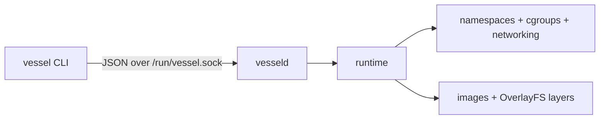

# Vessel 🚢

Vessel is a small container runtime written in Rust. It creates isolated Linux
processes directly with namespaces, cgroups v2, OverlayFS, `pivot_root`, and
virtual Ethernet devices.

The project is intended for learning how container runtimes work. It is not a
production container engine or a security boundary for untrusted workloads.



## Requirements

Vessel must run on Linux. It relies on Linux-specific kernel features and will
not run directly on macOS or Windows. A Linux VM works; for example, Kali Linux
running under UTM on an Apple Silicon Mac.

- Linux with cgroups v2 and OverlayFS
- Root privileges for the daemon
- Rust 1.85 or newer (the workspace uses Rust edition 2024)
- `wget`, `tar`, `iproute2`, and `iptables`
- An `aarch64` or `x86_64` Alpine minirootfs matching the host architecture

On Debian or Kali Linux, install the system packages with:

```bash
sudo apt update
sudo apt install -y build-essential curl wget tar git iproute2 iptables
```

Install Rust with [rustup](https://rustup.rs/) if it is not already available:

```bash
curl --proto '=https' --tlsv1.2 -sSf https://sh.rustup.rs | sh
source "$HOME/.cargo/env"
rustc --version
```

Confirm that cgroups v2 and OverlayFS are available:

```bash
stat -fc %T /sys/fs/cgroup
grep overlay /proc/filesystems
```

The first command should print `cgroup2fs`, and the second should include
`overlay`.

## Build

Clone the repository and build the workspace:

```bash
git clone <repository-url>
cd vessel
cargo build --workspace
```

The development binaries are written to:

```text
target/debug/vessel
target/debug/vesseld
```

For an optimized build:

```bash
cargo build --release --workspace
sudo install -m 0755 target/release/vessel /usr/local/bin/vessel
sudo install -m 0755 target/release/vesseld /usr/local/bin/vesseld
```

The examples below use the development binaries. If you install the release
binaries, replace `./target/debug/vessel` with `vessel` and
`./target/debug/vesseld` with `vesseld`.

## Configure the Alpine image

Vessel currently pulls one Alpine minirootfs from a URL hardcoded in
`crates/storage/src/image.rs`. The archive architecture must match the Linux
host. Check it with:

```bash
uname -m
```

Set the `url` in `pull_image` to the corresponding archive:

| `uname -m` | Alpine architecture | URL |
| --- | --- | --- |
| `aarch64` or `arm64` | `aarch64` | `https://dl-cdn.alpinelinux.org/alpine/v3.23/releases/aarch64/alpine-minirootfs-3.23.5-aarch64.tar.gz` |
| `x86_64` or `amd64` | `x86_64` | `https://dl-cdn.alpinelinux.org/alpine/v3.23/releases/x86_64/alpine-minirootfs-3.23.5-x86_64.tar.gz` |

For example, on an `aarch64` VM:

```rust
let url = "https://dl-cdn.alpinelinux.org/alpine/v3.23/releases/aarch64/alpine-minirootfs-3.23.5-aarch64.tar.gz";
```

Use a versioned Alpine path instead of `latest-stable`; otherwise, a future
stable release can make the pinned filename unavailable. Rebuild after changing
the URL:

```bash
cargo build --workspace
```

## Configure networking

Vessel expects a bridge named `vessel0` at `10.0.0.1/24`. Create it before
starting a container:

```bash
sudo ip link show vessel0 >/dev/null 2>&1 || \
    sudo ip link add vessel0 type bridge
sudo ip addr replace 10.0.0.1/24 dev vessel0
sudo ip link set vessel0 up
sudo sysctl -w net.ipv4.ip_forward=1
```

The bridge is enough for basic container tests. To give containers outbound
network access, add forwarding and NAT rules:

```bash
OUTBOUND_INTERFACE=$(ip route show default | awk '{print $5; exit}')

sudo iptables -t nat -C POSTROUTING \
    -s 10.0.0.0/24 -o "$OUTBOUND_INTERFACE" -j MASQUERADE 2>/dev/null || \
sudo iptables -t nat -A POSTROUTING \
    -s 10.0.0.0/24 -o "$OUTBOUND_INTERFACE" -j MASQUERADE

sudo iptables -C FORWARD -i vessel0 -j ACCEPT 2>/dev/null || \
    sudo iptables -A FORWARD -i vessel0 -j ACCEPT

sudo iptables -C FORWARD -o vessel0 \
    -m conntrack --ctstate RELATED,ESTABLISHED -j ACCEPT 2>/dev/null || \
sudo iptables -A FORWARD -o vessel0 \
    -m conntrack --ctstate RELATED,ESTABLISHED -j ACCEPT
```

These commands configure the current boot only. Run them again after rebooting
unless you make the bridge, forwarding, and firewall configuration persistent.

## Start the daemon

The daemon must run as root because it creates mounts, namespaces, cgroups,
network interfaces, and runtime data under `/var/lib/vessel`.

In one terminal:

```bash
sudo ./target/debug/vesseld
```

The daemon should report:

```text
vesseld listening on /run/vessel.sock
```

Keep it running and use a second terminal for the CLI.

## Pull and run Alpine

Pull the configured root filesystem:

```bash
sudo ./target/debug/vessel pull alpine
sudo ./target/debug/vessel images
```

Run a command and save the returned container ID:

```bash
ID=$(sudo ./target/debug/vessel run alpine \
    /bin/sh -c 'echo "hello from Vessel"; hostname; uname -m')
echo "$ID"
```

Container standard output and standard error are captured in a log file rather
than attached to the terminal:

```bash
sudo ./target/debug/vessel logs "$ID"
```

Stop and remove the container:

```bash
sudo ./target/debug/vessel stop "$ID"
sudo ./target/debug/vessel rm "$ID"
```

## Command reference

| Command | Purpose |
| --- | --- |
| `vessel pull IMAGE` | Download the configured Alpine root filesystem and register it as `IMAGE` |
| `vessel images` | List locally available images |
| `vessel run IMAGE [COMMAND...]` | Create and start a container, returning its ID |
| `vessel ps` | List container metadata, PIDs, and recorded states |
| `vessel logs ID` | Print a container's captured output |
| `vessel stop ID` | Send `SIGTERM`, then `SIGKILL` if necessary |
| `vessel rm ID` | Remove a stopped container and its writable layer |
| `vessel commit ID IMAGE` | Save a stopped container's changes as a new image |
| `vessel build IMAGE [CONTEXT]` | Copy a directory into an Alpine container and commit it as an image |

Run `vessel --help` or `vessel <command> --help` for CLI help.

### Long-running container

```bash
ID=$(sudo ./target/debug/vessel run alpine sleep 300)
sudo ./target/debug/vessel ps
sudo ./target/debug/vessel stop "$ID"
sudo ./target/debug/vessel rm "$ID"
```

### Commit a modified container

```bash
ID=$(sudo ./target/debug/vessel run alpine \
    /bin/sh -c 'echo "created in a container" > /message.txt')

sudo ./target/debug/vessel commit "$ID" my-alpine

NEW_ID=$(sudo ./target/debug/vessel run my-alpine cat /message.txt)
sudo ./target/debug/vessel logs "$NEW_ID"
```

### Build an image from a directory

```bash
mkdir -p /tmp/vessel-demo
echo "Hello from a built image" > /tmp/vessel-demo/hello.txt

sudo ./target/debug/vessel build demo-image /tmp/vessel-demo

ID=$(sudo ./target/debug/vessel run demo-image cat /hello.txt)
sudo ./target/debug/vessel logs "$ID"
```

`build` does not interpret a Dockerfile. It copies the context directory into
the container root filesystem and commits the resulting writable layer.

## Storage and runtime paths

| Path | Contents |
| --- | --- |
| `/var/lib/vessel/images` | Image manifests |
| `/var/lib/vessel/layers` | Extracted read-only image layers |
| `/var/lib/vessel/containers` | Container metadata, writable layers, merged filesystems, and logs |
| `/sys/fs/cgroup/vessel` | Per-container cgroups |
| `/run/vessel.sock` | CLI-to-daemon Unix socket |

## Project layout

```text
cmd/
├── vessel/       CLI client
└── vesseld/      privileged daemon
crates/
├── api/          request and response types
├── namespaces/   namespaces, cgroups, mounts, and networking
├── runtime/      container lifecycle operations
└── storage/      images, layers, metadata, and OverlayFS
```

## Current limitations

- Linux only; the runtime cannot execute directly on macOS or Windows.
- The image URL is hardcoded and `pull` currently downloads Alpine regardless
  of the requested image name.
- No interactive TTY, `exec`, attach, volume, port-publishing, or log-following
  support.
- Every container is assigned `10.0.0.2`, so only one networked container should
  run at a time.
- Container DNS is not configured automatically.
- A naturally exited process can remain recorded as `Running`; `vessel stop ID`
  reconciles it to `Stopped`.
- Images are always tagged `latest`; there is no image-removal command.
- The default cgroup limits are approximately 2% CPU, 100 MB hard memory, and
  80 MB soft memory.
- Network, cgroup, and storage cleanup is incomplete. Reboots may be required
  during development after namespace or mount failures.

## Development

Useful checks while working on the project:

```bash
cargo fmt --all --check
cargo clippy --workspace --all-targets
cargo test --workspace
```

Because the runtime uses Linux-only APIs, run builds and tests on Linux or in a
Linux VM.

## Troubleshooting

### Cannot connect to the daemon

Start `vesseld` as root and confirm the socket exists:

```bash
sudo ./target/debug/vesseld
ls -l /run/vessel.sock
```

### `Exec format error`

The Alpine root filesystem does not match the host architecture. Check
`uname -m`, select the matching archive in `crates/storage/src/image.rs`, rebuild,
and pull the image again.

If a failed pull already created image metadata, remove that specific image and
retry:

```bash
sudo rm -rf /var/lib/vessel/images/alpine
sudo ./target/debug/vessel pull alpine
```

### `Cannot find device "vessel0"`

Repeat the commands in [Configure networking](#configure-networking).

### Cgroup errors

Confirm that the host uses cgroups v2 and exposes the required controllers:

```bash
stat -fc %T /sys/fs/cgroup
cat /sys/fs/cgroup/cgroup.controllers
```

The controller list should include `cpu` and `memory`.
